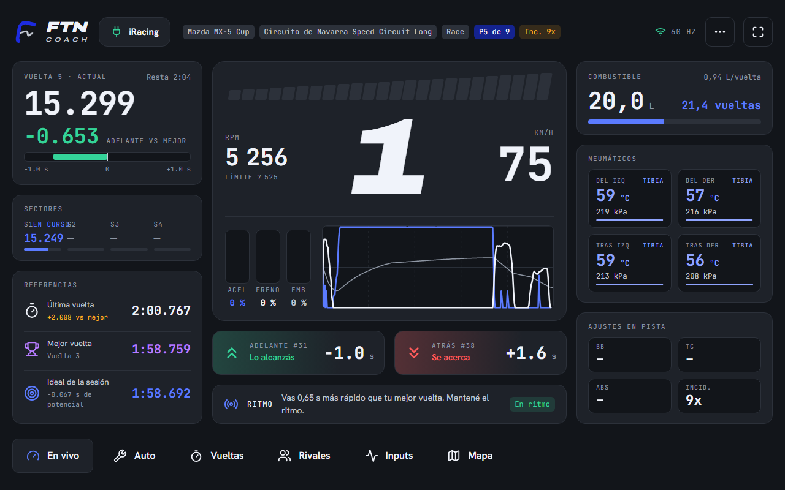
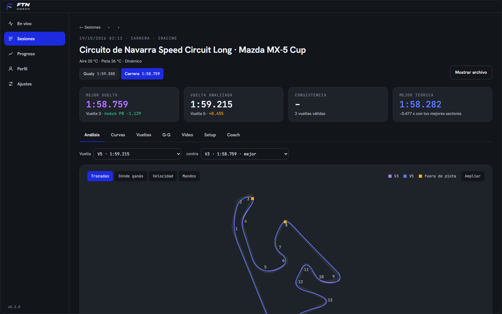
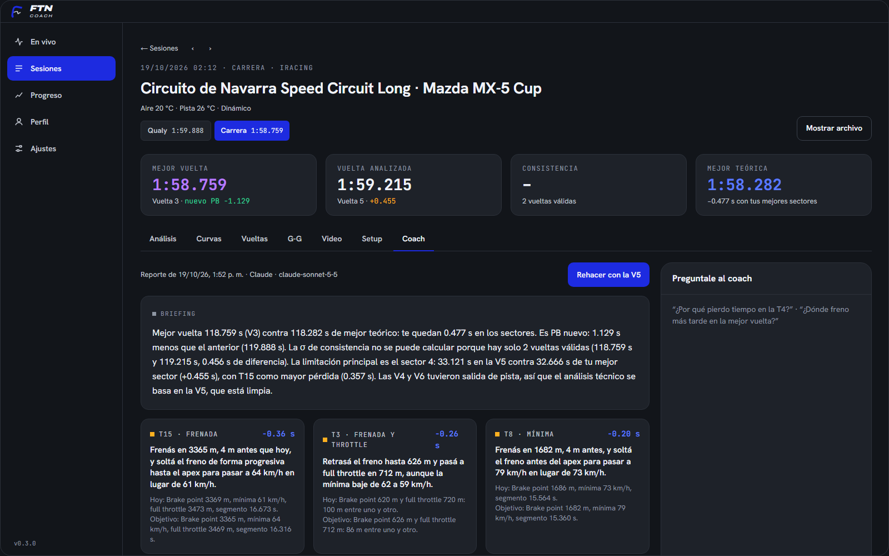

# FTN Coach

Telemetría en vivo y coach de sim racing para **iRacing** y **Assetto Corsa**.
Open source (MIT).

https://github.com/user-attachments/assets/02101a69-b295-483a-9d80-0f3c93866182



| Análisis de la sesión | Coach |
| --- | --- |
|  |  |

## Para el piloto

1. Bajá `FTN-Coach-Setup-x.y.z.exe` de [Releases](https://github.com/FranTheNegro/FTNCoach-OpenSource/releases/latest)
   e instalalo (no pide permisos de administrador).
2. Abrí FTN Coach y después el simulador. Se conecta solo: no hay que configurar
   carpetas ni puertos.
3. **Dashboard en la tablet o el celular:** en la pantalla *En vivo* aparece un
   código QR. Escanealo con un dispositivo conectado al mismo wifi y se abre en el
   navegador. La primera vez Windows pregunta si FTN Coach puede usar la red:
   aceptá para redes privadas.

El dashboard tiene seis páginas (se cambian tocando abajo o deslizando):

- **En vivo:** shift lights que parpadean violeta al llegar al corte, marcha y
  velocidad, vuelta actual con delta, sectores, referencias (última, mejor e ideal),
  acelerador/freno/embrague con su traza, distancia con el de adelante y el de atrás
  (verde si lo alcanzás, rojo si se acerca), combustible, gomas y ajustes en pista.
- **Auto:** temperatura de gomas en tres zonas, presión, desgaste, frenos, reparto
  de freno en barra con el 50 % marcado, agua, aceite y estrategia de box.
- **Vueltas:** mejor vuelta, típica, consistencia y potencial (suma de mejores
  sectores), tabla de las últimas vueltas con sectores y las trazas de velocidad y
  delta contra la mejor.
- **Rivales:** ordenados por posición en pista, con clase, iRating, última vuelta y
  distancia. Solo iRacing; Assetto Corsa no publica los rivales y la página lo avisa.
- **Inputs:** trazas de acelerador, freno y volante y el diagrama de fuerzas G.
- **Mapa:** el trazado real del circuito con tu auto encima, delta, tiempo,
  velocidad y marcha.

Los sectores, el ideal y las trazas las calcula el propio dashboard con lo que ve
pasar: si lo abrís a mitad de una vuelta, esa vuelta queda sin sectores. Lo que el
simulador no informa se muestra como «–».

### Sesiones y análisis

En *Sesiones* aparecen todas tus sesiones, agrupadas por día:

- **iRacing:** se leen los `.ibt` que guarda el simulador (activá la telemetría en
  el auto con `Alt+L`).
- **Assetto Corsa:** como el juego no guarda telemetría, FTN Coach graba cada
  sesión mientras corrés (`.ftnrec` en `Documentos/FTN Coach/Sesiones`). Se puede
  desactivar, y activar también para iRacing, en *Ajustes → Grabación*.

Cada sesión muestra mejor vuelta, consistencia y mejor vuelta teórica; compara dos
vueltas cualquiera (velocidad, delta acumulado, pedales, volante, marcha y
sectores) y marca en el mapa las curvas donde perdés tiempo, con qué cambiar.
También la compara con tus sesiones anteriores en el mismo auto y pista: si es
nuevo PB y cuánto te separa de tu ideal histórica (la suma de tus mejores
sectores). *Progreso* muestra esa evolución por combinación.

### Mapa del circuito

El trazado es siempre un dato fijo del circuito, nunca se dibuja a partir de tus
vueltas:

- **iRacing:** el mapa oficial de iRacing (se descarga una vez y queda en caché),
  alineado con el GPS de tus vueltas. Las curvas toman la numeración oficial.
- **Assetto Corsa:** los bordes de pista de la línea de la IA del propio circuito
  (`ai/fast_lane.ai`) y los nombres de curva de `data/sections.ini`.

Si un circuito no tiene mapa, se muestra solo tu trazada y se avisa.

### Coach con IA

En la pestaña *Coach* de una sesión, la IA lee la telemetría y devuelve un
briefing, las tres correcciones que más tiempo te dan, el análisis curva por curva
y un ejercicio para el próximo stint; después le podés hacer preguntas. Siempre
usa tu propia cuenta; se elige en *Ajustes → Coach*:

| Proveedor | Cuánto gastás | Qué necesitás |
|---|---|---|
| **Gemini** | Nada con los modelos gratis (Gemini 3.8 Flash, Flash-Lite, Gemma 4) | Una API key gratis de [Google AI Studio](https://aistudio.google.com/apikey), sin tarjeta |
| **OpenRouter** | Nada con los modelos `:free` (50 pedidos por día) | Una cuenta gratis y su [API key](https://openrouter.ai/settings/keys) |
| **Claude · tu suscripción** | Lo que ya pagás de Claude Pro o Max | [Claude Code](https://claude.com/code) instalado y logueado con tu cuenta; FTN Coach lo usa sin herramientas ni acceso a tus archivos |
| **Claude · API key** | Por uso (Haiku 5.5 cuesta menos de un centavo de dólar por reporte) | Una API key de la [consola de Anthropic](https://console.anthropic.com/settings/keys) |
| **OpenCode Zen** | Por uso, con modelos muy baratos (DeepSeek, GLM, Kimi, Qwen, Claude) | Crédito y API key de [OpenCode](https://opencode.ai/zen) |
| **OpenCode Go** | La suscripción de OpenCode Go | La misma API key de OpenCode |

Las API keys se guardan cifradas en la PC. Los modelos gratis de OpenCode solo
funcionan dentro de OpenCode, por eso no aparecen.

### App dentro de Assetto Corsa

Con Custom Shaders Patch instalado, *Ajustes → Assetto Corsa → Instalar* copia una
app Lua al juego: delta, última y mejor vuelta, combustible y el consejo para la
próxima curva, sacado de tus sesiones anteriores en ese circuito y con ese auto.
Se activa en la barra de apps de AC. No es obligatoria: la telemetría se lee igual
sin ella.

Para probar sin correr: *En vivo → Probar sin el simulador* reproduce una sesión
grabada de iRacing (`.ibt`) como si estuvieras en pista.

### Simuladores

| | Cómo se lee | Notas |
|---|---|---|
| iRacing | Memoria compartida `IRSDKMemMapFileName` (60 Hz) | Delta, shift lights y tiempos los da el sim. |
| Assetto Corsa | Memoria compartida `acpmf_physics/graphics/static` | La app Lua es opcional. El delta y la validez de las vueltas los calcula FTN Coach. Las shift lights se aproximan con el corte del motor. |

## Desarrollo

Requisitos: Node 22+ y Windows (la lectura de memoria compartida es de Windows;
el resto corre en cualquier sistema).

La app está en `app/` (las rutas de abajo son relativas a esa carpeta).

```bash
cd app
npm install
npm run dev        # app con hot reload; el dashboard queda en http://<tu-ip>:8090
npm test           # tests (los que usan .ibt reales se saltean si no hay)
npm run typecheck
npm run dist       # instalador en dist/
```

Variables útiles en desarrollo:

- `FTN_DEMO=<ruta.ibt>` arranca directo en modo demo.
- `FTN_IBT_DIR=<carpeta>` carpeta de `.ibt` para los tests (por defecto
  `Documentos/iRacing/telemetry`).
- `FTN_CAPTURE=<archivo.png>` guarda una captura de la ventana al abrir y cierra
  la app. `FTN_CAPTURE_JS` se ejecuta antes en la ventana (para navegar) y
  `FTN_CAPTURE_DELAY` fija la espera en ms.

### Arquitectura

```
src/
├── shared/            protocolo del WebSocket (LiveFrame…) y contrato de la app
├── main/              proceso principal (Node)
│   ├── telemetry/
│   │   ├── reader-worker.ts   hilo lector: busca el sim y lo lee a 60 Hz
│   │   ├── iracing/           irsdk: memoria en vivo, archivos .ibt, session info
│   │   ├── ac/                memoria compartida de Assetto Corsa
│   │   ├── replay.ts          modo demo
│   │   ├── lap-tracker.ts     vueltas, validez, consumo y delta propio
│   │   └── engine.ts          arma los frames y los publica
│   ├── analysis/      hilo de análisis: biblioteca de sesiones, grabación .ftnrec,
│   │   │              vueltas, curvas, comparaciones y datos para el coach
│   │   └── track-map/ mapas fijos: SVG oficial de iRacing alineado al GPS y AC
│   ├── coach/         proveedores de IA (APIs con streaming y Claude Code), prompts y reportes por sesión
│   ├── ac-app.ts      instalación de la app Lua en Assetto Corsa
│   ├── lan/server.ts  HTTP + WebSocket para los dashboards de la red (solo lectura)
│   └── settings.ts    ajustes en %APPDATA%/FTN Coach/settings.json
├── preload/           puente seguro entre la app y la ventana
└── renderer/
    ├── src/           app de escritorio (React)
    ├── dashboard/     dashboard para tablet/celular (React, lo sirve el servidor LAN)
    └── ui/            tokens de marca, cliente WebSocket y formatos compartidos
```

Cualquier dashboard puede conectarse a `ws://<ip>:8090/ws` y recibir mensajes JSON
`hello`, `status`, `meta`, `laps` y `frame` (ver `src/shared/live.ts`). Además:

- `GET /api/track-map?id=<trackId>&slug=<trackSlug>`: mapa del circuito en metros
  (ver `TrackGeometry` en `src/shared/analysis.ts`).
- `GET /api/ingame`: resumen para la app de AC (delta, vueltas, combustible y
  consejos por curva).

La app de Assetto Corsa está en `resources/ac-app/FTNCoach`.

### Fuentes

Se usan las alternativas OFL del manual de marca (Archivo, Hanken Grotesk,
JetBrains Mono). Las fuentes comerciales del manual no se distribuyen.
